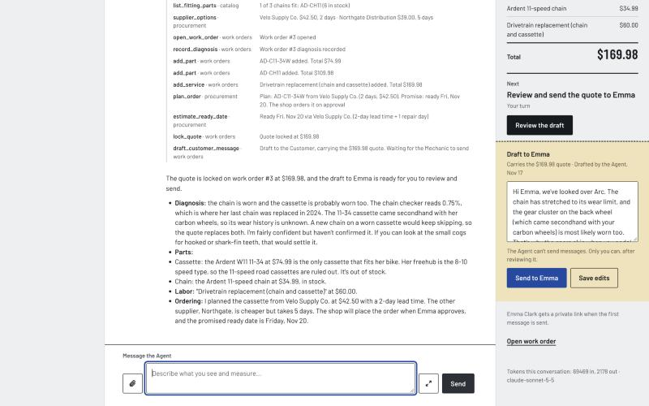
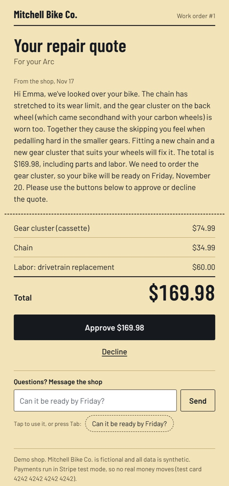
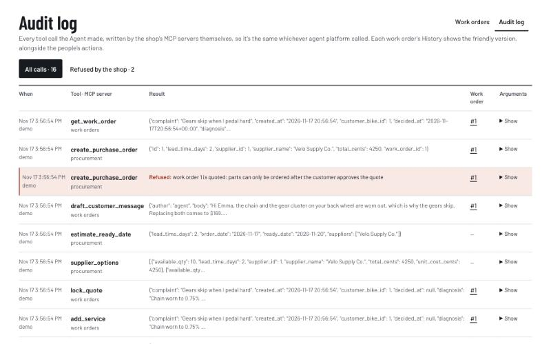
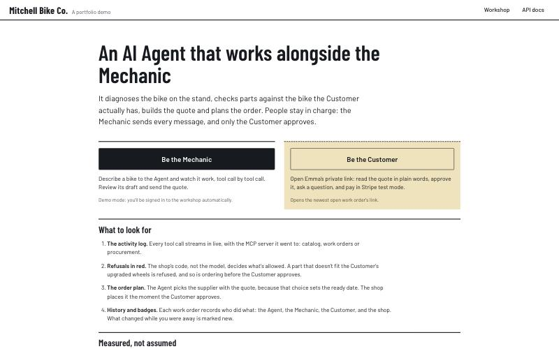

# Mitchell Bike Co.

A fictional bike shop where an AI Agent works alongside the Mechanic, built to demonstrate agentic workflows over the Model Context Protocol (MCP). The Agent diagnoses, checks parts against the bike the Customer actually has, quotes, and plans the order. People stay in charge: the Mechanic sends every message, only the Customer approves, and the shop's own code enforces both.



> Mitchell Bike Co. is not a real business. All data is synthetic, the parts and brands are invented (the interface standards are real), and payments run in Stripe test mode.

## Try it in two minutes

Requires Python 3.12 or newer, [uv](https://docs.astral.sh/uv/), and an Anthropic API key for the Agent.

```
cp .env.example .env      # then add ANTHROPIC_API_KEY, and set DEMO_MODE=1 for the front door's shortcuts
make reset                # create the database and load the seed data
make api                  # then open http://127.0.0.1:8000
```

In demo mode the front door opens the demo stage (**Play both sides at once**): the workshop at full width, Emma's phone in a **Customer POV** overlay that flashes when it's her turn, and a guide that says whose turn it is and rings the next button. It also has **Be the Mechanic** (signed in automatically in demo mode), **Be the Customer** (Emma's private link, once the quote is sent), **Reset the demo**, **Generate a sample quote** (to try the Customer's side without the Agent), and the latest eval result. Each Agent turn costs a few cents. For a two-window walkthrough, see the [demo script](docs/demo-script.md).

## What to look for

- **The activity log.** Every tool call streams in live, with the MCP server it went to (catalog, work orders or procurement) and a plain summary of what came back. The summaries are written by code from the real results, never by the model.
- **The shop's rules, not the model, decide.** A part that doesn't fit the Customer's actual bike is refused. So is ordering before the Customer approves, or more than they approved. In practice the Agent checks first and rarely triggers a refusal; `make demo` plays a scripted run that does, and the audit log shows both.
- **The order plan.** The Agent chooses the supplier with the quote, because that choice sets the ready date it promises. The shop places the order itself the moment the Customer approves: no second model call.
- **Who did what.** Each work order's History records the Agent's tool calls, the Mechanic's actions, the Customer's (opening the link, asking, approving, paying) and the shop's. New activity shows as badges, and the workspace updates without a reload.

| | |
| --- | --- |
|  |  |
|  |  |

## The story

The Customer, Emma, brings in a gravel bike: "my gears skip when I pedal hard." The Mechanic puts it on the stand and tells the Agent what they see and measure ("skips under load in the smaller cogs, chain checker reads 0.75%"). The Agent reads the bike's service history (the cassette came secondhand with the wheels and has never been replaced) and confirms a worn chain and cassette, saying how confident it is and what would settle it.

Then the twist: the catalog says this bike model takes one cassette, but Emma upgraded her wheels, so it needs a different one. The Agent checks fit against the bike she actually has. The right cassette is out of stock, so it compares suppliers, plans the order from Velo (2 days, which meets the date it will promise rather than the cheaper 5-day option), locks the quote, and drafts Emma a plain-language message.

The Mechanic reviews and sends it. Emma approves that exact amount from her private link, and the shop places the planned order. A next-step bar walks the Mechanic through parts received, booking on the promised date, the repair, and the Agent's "ready to pick up" message. Emma pays in Stripe test mode.

## Personas

- **Customer:** owns the bike and pays for the repair. Talks to the shop through messages, and approves or declines the quote from a private link.
- **Mechanic:** shop staff with the bike on the stand. Works with the Agent and reviews everything it drafts for the Customer.
- **Agent:** the shop's AI service agent (Claude Sonnet 5.5). Diagnoses alongside the Mechanic, checks fit and stock, quotes, plans the order and drafts messages. It cannot send a message or approve on the Customer's behalf.

## How it is put together

- `shop/` holds the business rules and the database (SQLite). It has no AI code, and every rule is unit-tested without spending tokens.
- `mcp_servers/` exposes the shop as three MCP servers (catalog, work orders, procurement) on the official Python SDK. Every tool call is written to an audit log and, when it touches a work order, to that work order's history. The Agent gets no tool to send a message or approve a quote.
- `agents/` holds the Agent: its prompt (`agents/prompts/service_agent.md`) and a small runtime interface, so the agent platform can be swapped. The Anthropic runtime runs Claude Sonnet 5.5 against the three servers and stores each conversation exactly as sent.
- `api/` is the HTTP API (FastAPI): the Mechanic's endpoints behind a passcode, including the Agent chat (each turn streams its tool calls live over Server-Sent Events), the Customer's endpoints behind their private link, and Stripe Checkout in test mode.
- `web/` is the frontend in plain HTML, CSS and JavaScript, served by the API with no build step: the front door (`/`), the Mechanic's workspace (`/workshop`), and the Customer's page (`/c/{token}`).
- `evals/` measures the Agent. `make agent-check` plays the hero story against the real model and judges it by what ended up in the database: the latest run passed all 20 required checks (plus 3 advisory notes) for about 7 cents.

Why it's built this way is in the [decisions log](docs/decisions.md).

## Other ways in

- **`make demo`** plays the hero story through the three servers with a scripted client, including the two calls the shop refuses. No API key needed. Its own database: `data/demo.db`.
- **`make agent`** is a terminal chat as the Mechanic, with slash commands for what the Agent can't do (`/send`, `/approve`, `/reply`, `/photo`, `/usage`).
- **`make sample`** adds Emma's quoted work order and prints her link (`ARGS=--done` for a finished repair, ready to pay with test card `4242 4242 4242 4242`).
- **Claude Code as the Agent:** the repo's `.mcp.json` connects Claude Code to the three servers.
- **The API by hand:** `make api`, then http://127.0.0.1:8000/docs.
- **`make test`** runs the unit tests, which never call the model; **`make servers`** runs the three MCP servers over HTTP.

## Roadmap

Work is split into milestones, each defined by what it delivers rather than how long it takes.

| Milestone | Delivers | Status |
| --- | --- | --- |
| M0 | Scaffold, schema, CI, decisions log | Done |
| M1 | Seed data and core business rules in `shop/` (fit, stock, quote approval, ordering) | Done |
| M2 | MCP servers: catalog, work orders (including Customer messages), procurement | Done |
| M3 | The Agent, behind the `AgentRuntime` interface (Dust runtime deferred) | Done |
| M4 | Backend API: Mechanic and Customer endpoints, Agent chat (streamed), Stripe test-mode payments | Done |
| M6 | Web frontend: front door, Mechanic workspace with live activity log and history, Customer page | Done |
| M7 | Demo flow: the Agent on the work order screen, a side-by-side demo stage, reset without a sample, a photo on the hero message | In progress |
| M5 | Eval suite: more scenarios than the hero story | Next |
